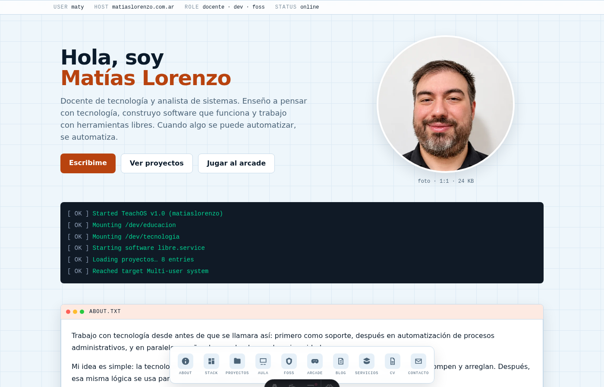
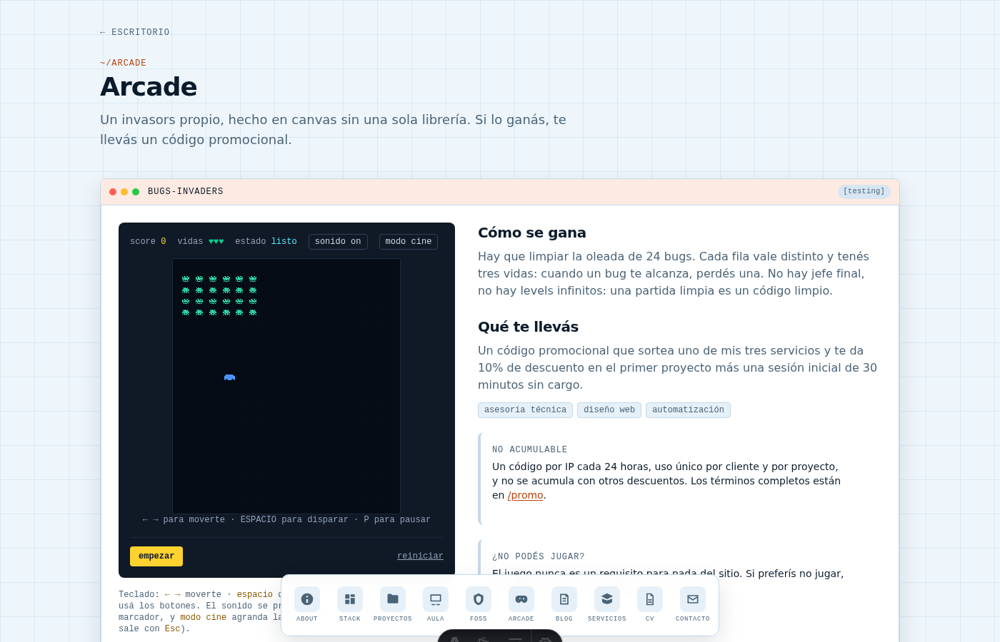

<div align="center">

# maty-web

**Sitio personal de Matías Lorenzo** — docente de tecnología, developer y divulgador de software libre.

La web entera es un **escritorio Linux**: cada sección es una ventana, la barra lateral es un dock
y hay una terminal jugable con comandos reales del sitio. Incluye un **arcade propio** (Space
Invaders) que, al completarse con una partida legítima, libera un **código promocional** para un
primer servicio de 30 minutos sin cargo.

[](https://github.com/melorenzo/maty-web/actions/workflows/ci.yml)
[](LICENSE)
[](https://astro.build)
[](https://workers.cloudflare.com)
[](https://nodejs.org)

</div>

---

## Capturas

<table>
  <tr>
    <td width="50%"></td>
    <td width="50%"></td>
  </tr>
  <tr>
    <td align="center"><sub>Portada: escritorio, terminal y dock</sub></td>
    <td align="center"><sub>Arcade: canvas puro, sin librerías</sub></td>
  </tr>
</table>

## Qué hay adentro

| Sección | Qué hace |
| --- | --- |
| **Portada** | Escritorio Linux: ventanas, dock y una terminal con comandos reales (`help`, `projects`, `cv`, `contact`, `clear`…). |
| **Proyectos** | Fichas de proyectos reales escritos en Markdown (`src/content/proyectos/`) con contexto, problema y solución. |
| **Aula** | Rutas de aprendizaje y materiales para docentes: programación, IA, web, hardware y automatizaciones. |
| **Arcade** | Space Invaders hecho en canvas, sin librerías: motor propio en TypeScript, teclado y táctil, modo cine y efectos 8-bit. |
| **Códigos** | El arcade libera códigos promocionales (10% + 30 min sin cargo) validados en el servidor. |
| **CV** | Trayectoria completa en HTML y **PDF descargable**, generado desde los mismos datos tipados. |
| **Contacto** | Formulario con Turnstile, envío por Resend y validación del código promocional. |
| **Software libre** | Herramientas open source que usa y recomienda. |

## Stack

- [Astro 7](https://astro.build) con `output: 'static'` y rutas API renderizadas en el servidor.
- React 19 + TypeScript 6 para las islas interactivas (terminal, paleta de comandos, arcade, formulario).
- Tailwind CSS 4 vía `@tailwindcss/vite`, con tokens CSS y tema claro/oscuro.
- Cloudflare Workers (`@astrojs/cloudflare`) + KV + Rate Limiting + Turnstile + Resend.
- Vitest para los tests de lógica pura.

## Arranque rápido

```bash
nvm use 24
npm install
cp .env.example .env
npm run dev
```

El sitio corre en `http://localhost:4321`. La terminal y la paleta de comandos se prueban con la
tecla `/` o la tecla `` ` ``.

## Comandos

| Comando | Qué hace |
| --- | --- |
| `npm run dev` | Servidor de desarrollo |
| `npm run check` | Chequeo de tipos |
| `npm run lint` | ESLint |
| `npm run test` | Tests unitarios |
| `npm run build` | Build de producción |
| `npm run verify` | check + lint + test + build |
| `npm run deploy` | Build + `wrangler deploy` |
| `npm run deploy:dry` | Build + dry run de Wrangler |
| `npm run cf:kv:create PROMO` | Crear el namespace KV del promo |

## Estructura

```
src/
  components/astro/   ventanas, dock, tarjetas, SEO
  components/react/   islas: terminal, paleta, tema, arcade, formulario
  content/proyectos/  fichas de proyectos en Markdown
  data/               contenido tipado del perfil (fuente de verdad)
  layouts/            Base.astro y Page.astro
  lib/                lógica pura: game, promo, contact, terminal, blog, cv-pdf
  pages/              rutas y endpoints /api
  styles/global.css   tokens y tema
```

`src/data/` es la **única fuente de verdad**: el HTML y el PDF del CV se arman a partir de ahí, así
que no hay dos versiones del mismo contenido que se desincronicen.

## Variables de entorno

Copiá `.env.example` a `.env`. Las tres claves sensibles (Turnstile, Resend y `PROMO_SECRET`) van
como secretos de Wrangler en producción:

```bash
npx wrangler secret put RESEND_API_KEY
npx wrangler secret put TURNSTILE_SECRET
npx wrangler secret put PROMO_SECRET
```

Sin `TURNSTILE_SECRET`, el formulario omite la verificación (solo para desarrollo local).

## Deploy

El sitio se publica **en tu server propio con Docker** y queda exposed por el túnel de Cloudflare
que ya tenés configurado: la regla `matiaslorenzo.fullware.com.ar → http://192.168.0.94:8027` del
túnel `Mytunnel` apunta al puerto que publica el contenedor, y Cloudflare termina el TLS.

1. `npm run build` genera `dist/client` (estáticos) y `dist/server` (Worker).
2. `npm run pack:deploy` genera el `tar.gz` para llevar al server.
3. En el server: `docker compose up -d --build` (publica el puerto 8027).

Como alternativa, el mismo código se puede subir como **Cloudflare Workers** (`npm run deploy`),
que en vez del runtime local usa el KV y el rate limiting reales de Cloudflare.

El dominio canónico se define con `SITE_URL` al construir:

```bash
SITE_URL=https://matiaslorenzo.fullware.com.ar npm run build
```

Los dos caminos están documentados en [DEPLOY.md](DEPLOY.md).

## Arcade y códigos promocionales

- El juego vive en `src/lib/game/` (motor puro, sin DOM) y la isla React solo dibuja.
- La música es `public/audio/arcade-theme.mp3` y **arranca con la primera interacción** (tecla o
  botón), como exigen los navegadores; el botón `sonido` del marcador lo apaga. Los efectos 8-bit
  (disparo, baja, impacto, victoria) se sintetizan con WebAudio, sin archivos.
- Una partida legítima exige: 24 impactos, al menos 24 disparos y un score exacto de **420**.
- El servidor no confía en el cliente: recalcula el resultado y valida el reto HMAC
  (`POST /api/promo/challenge` → `POST /api/promo/redeem`).
- Reglas del código: 10% de descuento, sesión inicial de 30 minutos sin cargo, 1 código por IP
  cada 24 h, uso único, no acumulable, 30 días de vigencia y tope global de 15 códigos por día.
- Formato: `MATE-<ASES|DISE|AUTO>-XXXX`.

## Privacidad

Sin cookies de seguimiento ni analítica de terceros. Los datos del formulario se usan solo para
responder. Detalle en `/privacidad`.

## Licencia

MIT. Ver [LICENSE](LICENSE) y [CONTRIBUTING.md](CONTRIBUTING.md).
